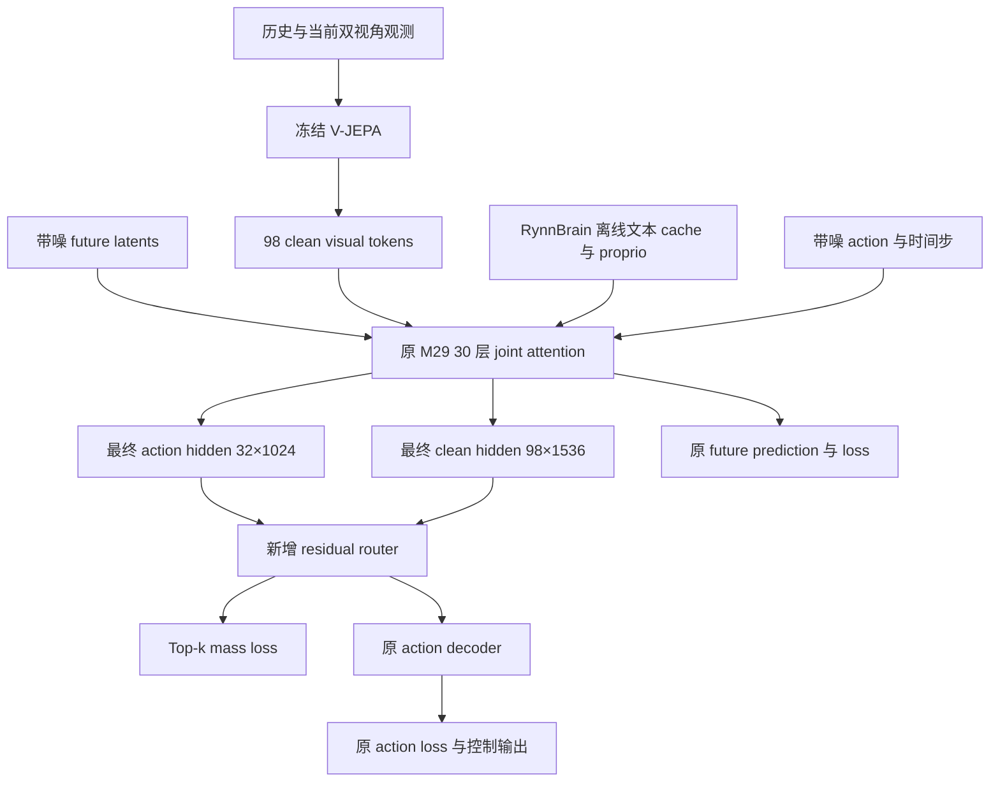

# CausalWAM × M29：动作相关稀疏读出研究方案与讨论记录

整理日期：2026-11-03。基于本轮论文阅读、用户提供的两份分析及对 `openwam-exp` 的代码检查。

状态更新（2026-11-04）：**已实现第一版 router、稀疏目标、调度、日志与保存加载，注册 E00+（B2）及 E00+-Dense（B1）。** 原始讨论及待验证机制保留如下；具体固定配置、验收记录和使用命令见 [E00+ 实现说明](E00_PLUS.md)。正式 GPU 训练与闭环评测尚未执行。最初代码检查时仓库 HEAD 为 `e2a50e6`，工作区存在既有修改；该 commit 不能单独代表源码状态。

本文区分四类信息：论文机制、本地代码事实、建议方案、待验证假设。后续实现前应重新核对实际配置和源码，并保存实验指纹。

## 1. 研究问题与推荐方向

核心问题：在固定的 **E00：M29 + 冻结 RynnBrain 1.1-9B 文本特征 + 冻结 V-JEPA 2.1 视觉特征** 上，额外加入一个动作条件化的 clean-context 读出，并对其 attention 施加集中正则，能否改善闭环控制及视觉扰动鲁棒性？

推荐第一版：

1. 保留原有 30 层 video/action joint attention。
2. 在最终 action hidden 与原 action decoder 之间增加 residual cross-attention router。
3. Query 来自最终 action hidden；Key/Value 首先只使用最终 clean visual hidden。
4. 对新增 router 的 attention 使用 top-k mass loss；保留 soft attention，不做 hard token pruning。
5. 固定原 video/action 目标及 E00 训练预算，先做 B0、B1、B2。

准确定位是 **Action-Relevant Sparse Routing / 动作相关的选择性视觉读出**。当前设计不直接保证因果表征解耦、全局 token 稀疏、计算加速或背景不变性。

决定研究价值的主要证据是：B2 相比同容量的 B1 有可重复的闭环收益；在经过控制的无关视觉干预下更稳定，同时对需要改变控制响应的相关干预仍作出合理响应。

## 2. 论文启发及其适用边界

### 2.1 CausalWAM：动作侧的选择性读取

论文在 generator 后增加残差 router，action hidden 查询 clean vision 与 task tokens；默认保留 dense 路径。正文读出采用 softmax 加权求和，稀疏项惩罚 top-k 以外的 attention mass。附录给出 routing width 512、8 heads、k=32、gate 初值 0.01、稀疏权重 0.01，第 1000 optimizer step 开始、随后 4000 steps 线性增长；稀疏梯度更新 router 和共享 tower。

来源：[CausalWAM §4、附录 H](https://arxiv.org/html/2610.42096v1)。本文采用其读出与正则思想；视觉专用 K/V、按 head 计算损失等属于本地迁移设计，应明确记录。理论中的机制支持集稀疏与工程中的 token attention 集中不能直接等同。

### 2.2 HiRAE：深度融合与残差预算

HiRAE 以冻结 DINOv3-L 最深层为 anchor，对 24 层特征使用 layer-wise experts 与逐位置的有符号 L2 归一化路由。浅、中、深组先做 dropout，再按每张图像的 Frobenius 范数裁限残差；预算分别为 anchor 范数的 0.025、0.075、0.150，之后相加并 LN。预算约束位于最终 LN 之前。生成模型训练阶段冻结 tokenizer。

来源：[HiRAE §3](https://arxiv.org/html/2609.37775v1#S3)。用户提供的讨论已概述该机制；其数值属于原论文设置，不是 M29 的推荐最优参数。

### 2.3 两者共同点与区别

| 维度 | HiRAE 启发 | CausalWAM 启发 |
|---|---|---|
| 选择对象 | Encoder 不同深度的信息 | 动作读取的上下文位置 |
| 选择条件 | 深层视觉特征 | Action hidden |
| 路由权重 | 有符号、L2 归一化 | Softmax 概率 |
| 主要约束 | 分组残差范数预算、dropout | Top-k attention mass 正则 |
| 本地潜在用途 | 控制多层补充信息的幅度 | 控制动作读出的集中程度 |

共同思想是保留主表示、学习补充路径；约束对象不同。Top-k 概率质量损失不能直接套到有符号 L2 权重上。Sigmoid gate 也不等价于相对于 anchor 的显式范数上界。

## 3. 已核实的 E00/M29 baseline

### 3.1 模型、输入与训练协议

| 项目 | 本地配置事实 |
|---|---|
| Baseline profile | `configs/experiments/E00.yaml` |
| 视觉编码 | 冻结 V-JEPA 2.1 G；1408 维；最后层特征 |
| 文本编码 | 冻结 RynnBrain 1.1-9B；离线 text-only；`avg_all_layers` |
| 文本规格 | 排除输入 embedding；32 个 decoder hidden 经 LN 后平均；最多 128×4096；保留 mask |
| 视觉采样 | 相对帧 `[-4,0,4,8,12,16,20,24,28,32]` |
| 视角 | front、wrist，各 224×224，独立编码后沿宽拼接 |
| 原始视觉 latent | `[B,1408,5,14,28]`，1 clean + 4 future |
| DiT patch | `(1,2,2)`，每个时间 latent 为 7×14=98 tokens |
| 总视觉 tokens | 490，其中 clean 98、future 392 |
| VideoDiT | 30 层，hidden 1536，FFN 7168，12 heads |
| ActionDiT | 30 层，hidden 1024，FFN 4096，每层与 video joint attention |
| 动作 | 32 步 chunk；动作与 proprio 的统一槽位维度均为 80，含 padding |
| Proprio | 经可训练投影追加为 context token |
| 初始化 | M29 可训练策略从头训练；不把整个 RynnBrain 9B 常驻并联合训练 |
| 输入适配 | clean 直接投影；future 经 256 维 bottleneck |
| 注意力配置 | `mutual` + `clean_condition_causal` |
| 预测参数化 | video/action 均为 x prediction，再转换到 velocity 空间计算损失 |
| Loss 权重 | video/action 均为 1；REPA、S-VAE 关闭 |
| 训练预算 | global batch 256，参考 10690 steps；正式步数按锁定 sampler 确认 |
| 优化器 | AdamW，LR 1e-4，betas 0.9/0.95，weight decay 0.01，clip 1 |
| 评测 | 10 步去噪；标准 LIBERO 2000 trials；完整 corrected-text LIBERO-Plus 10030 trials |

配置依据：[E00](../configs/experiments/E00.yaml)、[protocol](../configs/protocol.yaml)、[实验说明](EXPERIMENT_PLAN.md)。本文件没有确认或填入 E00 的具体成功率；其他 encoder 的成绩不能代替 B0。

### 3.2 Clean 的含义与信息流

Clean 表示已知观测条件，不表示“原始局部 patch”或“未经过上下文混合”。一个 clean tubelet 包含历史与当前两帧，不是单张当前图像。

代码检查确认：

- V-JEPA 的 condition 编码单独运行，不读取未来观测。
- 每层 joint attention 的 clean queries 只读取 clean visual keys，不读取 future/action tokens。
- 每层 VideoDiT 随后执行对 context 的 cross-attention，因而 clean hidden 能读取文本及有效 proprio。
- clean visual tokens 之间可以全局交互，V-JEPA 自身也已混合上下文；一个位置的 hidden 不等于只包含该图像区域的信息。
- future/action 仍通过原 joint attention 交互；action hidden 已包含 dense 视觉与预测分支信息。

因此，最终 clean hidden 是**任务与 proprio 条件化的观测表示**。它没有来自 future/action token 的上述直接前向路径，但其参数仍可受联合训练梯度影响。

### 3.3 双视角布局与既有位置编码

已有 view embedding，以及视角局部宽度位置编码。展平顺序为 `t-h-view-w`，不是前 49 个 token 都属于 front。

单 clean tubelet 下：

\[
j(h,v,w)=(2h+v)\times7+w.
\]

因此 0–6 是 front 第 0 行，7–13 是 wrist 第 0 行，14–20 是 front 第 1 行，以此类推。统计、可视化、per-view mask 必须遵循实际布局；推广到其他 encoder 时从网格和视角元数据推导。

### 3.4 通道 bottleneck 与 token routing 的区别

现有 future bottleneck=256 约束未来输入的通道表示；新增 router 约束动作读出的上下文位置分布。二者作用不同，可以共存。第一轮不改现有 bottleneck。

## 4. 推荐的第一版结构

### 4.1 张量与公式

\[
H_a\in\mathbb R^{B\times32\times1024},\qquad
H_c\in\mathbb R^{B\times98\times1536}.
\]

投影到 512 维，拆为 8 heads，每个 head 64 维：

\[
Q=W_qH_a,\quad K=W_kH_c,\quad V=W_vH_c,
\]

\[
W=\operatorname{softmax}_j\left(QK^\top/\sqrt{64}+b\right),
\qquad W\in\mathbb R^{B\times8\times32\times98}.
\]

这里缩放使用每个 head 的维度。每个样本有 25088 个 attention 权重。可选关系偏置 b 应独立配置；第一轮不叠加复杂关系网络。

\[
R=W_o\operatorname{ConcatHeads}(WV),\qquad
H'_a=H_a+\sigma(\gamma)R,\qquad
\hat a=\operatorname{Decoder}(H'_a).
\]

若实际 gate 初值为 0.01，参数初始化应为：

\[
\gamma_0=\log(0.01/0.99)\approx-4.595.
\]

直接设置 gamma=0.01 会得到约 0.5025 的 gate。该项是实现注意事项，不是已经发现的现有代码 bug。

### 4.2 为何先选择 clean-visual-only K/V

Action hidden 已通过现有路径读取文本与 proprio，视觉专用 router 仍是任务条件化读出。若让视觉、文本、proprio 在同一 softmax 中竞争，稀疏项可能通过集中到文本或 proprio 而降低，未必改善视觉选择。

主实验只对 clean vision 路由；B3 再比较 vision+text。有效文本必须 mask padding；不要意外将追加的 proprio 当成文本，也不要让其可用性依赖是否进入 top-k。

### 4.3 接入位置

在 `DualSystemSelfAttnArchitecture.forward()` 中，`run_joint_loop()` 之后、`ab.extract_prediction(astate)` 之前：

- Q 来源：`astate.payload.x_action`。
- K/V 来源：`vstate.hidden_states` 的 clean prefix。
- clean token 数由 `num_clean_condition_latents × grid_height × grid_width` 推导，不写死 98。
- 残差回写 action hidden，随后使用原线性 decoder。
- 训练与每个推理去噪步使用相同的 router。

第一版不修改逐层 joint attention，也不为获得全主干 attention weights 而替换现有 SDPA。

## 5. 稀疏目标、训练与梯度

### 5.1 损失定义

本地建议采用每个 head、每个 action query 单独选 top-k：

\[
\ell_{bhi}=1-\sum_{j\in T_k(W_{bhi:})}W_{bhij},
\qquad
L=L_{\mathrm{video}}+L_{\mathrm{action}}
+\lambda(s)\operatorname{Mean}_{b,h,i\ \mathrm{valid}}\ell_{bhi}.
\]

明确 lambda 只乘一次。排除 padded action positions；概率沿有效 K/V 位置归一化。若某种 context 的有效长度不超过 k，该行的约束会退化为零，应记录而非误认为成功学到了稀疏性。

对 N=98、k=32，均匀分布的未加权损失为 1−32/98≈0.673；top-32 mass 达到 0.9 时为 0.1。这只是 attention 集中程度，不是相关性分数。

实现要求：在截断前、attention dropout 前的归一化概率上计算；softmax 与质量求和建议 FP32；不能 detach 所选权重。若先 hard top-k 并重归一化再计算该损失，top-k 和恒为 1，目标失效。

### 5.2 稀疏不等于裁剪

第一版读出仍对全部有效 V 加权。该目标不要求恰好 k 个 token，集中到 1 个也可以；不同 heads/queries 的选择并集可以很大。它不减少原 M29 的 490-token 主干计算，整体耗时可能略增加。

### 5.3 梯度作用范围

主方案正常反传：稀疏项经 Q/K 更新 router 的相关参数与产生 Ha/Hc 的 M29 主干；冻结 V-JEPA 和离线 RynnBrain 不被更新。稀疏项通常没有通向独立 V、输出投影和 gate 的直接路径；这些主要由任务损失学习。

“只在 router 上算正则”不等于“只训练 router”。原 world loss 定义不变，也不等于 world branch 的训练轨迹或性能不变。

备选消融：仅为稀疏项重新计算使用 `Ha.detach()`、`Hc.detach()` 的 Q/K 分数，并共享 router 参数；action readout 保持正常计算图。不能 detach 整个 router 输出。该消融用于隔离正则对共享主干的影响，第一轮不必加入。

### 5.4 建议起点与未决参数

| 参数 | 第一轮讨论起点 | 状态 |
|---|---|---|
| Router width / heads | 512 / 8 | 建议 |
| K/V | Final clean visual hidden | 主方案 |
| k | 32；后续 16、8 | 敏感性待验证 |
| Gate 有效初值 | 0.01 | 需正确 logit 初始化 |
| 最大 lambda | 0.01；必要时试 0.001 | 不同任务 loss 尺度下不可直接类比 |
| 稀疏启用步 | 1000 optimizer steps | 建议起点 |
| Ramp 时长 | 最初建议 2000；实现 E00+ 固定为 4000 | 优劣未验证，2000 留作后续敏感性对照 |
| 主干预算 | 沿用 E00 参考 10690 steps | 不随变体增加预算 |
| LR / 数据 / world-action loss | 沿用 E00 | 第一轮控制变量 |
| Router 专用 LR 倍率 | 不直接照搬论文倍率 | 若修改，独立记录 |

讨论没有确定 4000 优于 2000；实现阶段选 4000 作为固定起点，不应由“更像论文绝对步数”推导其更适合 M29。需结合从头训练、总步数、gate 与梯度平衡判断。调度使用 optimizer step，并随 checkpoint 恢复。

## 6. 核心风险与诊断方法

### 6.1 Logits 放大即可降低稀疏项

对于固定排序的分数 z，`softmax(alpha*z)` 在 alpha 增大、最大值唯一时会集中到同一个最大位置。Q/K 范数增长就可能降低 sparse loss，而不改善 token 排序。

记录 Q/K 范数、logits 标准差、attention entropy、选中位置变化和任务表现。若主要变化只有打分尺度，再考虑 QK normalization 或受控温度；B1/B2 应同时采用相同设置以保持公平。

### 6.2 小 gate 不保证残差小，也不保证动作变化小

gate 与输出投影存在幅度补偿。记录 `||gR||/(||Ha||+eps)`，但不能只看该 hidden 比值。

当前 decoder 是线性层。在固定同一次 forward 的 hidden 时：

\[
\Delta\hat a=W_{\mathrm{dec}}(gR).
\]

同时记录有效动作维度上的预测变化，以及完整采样关闭 router 的影响。低 hidden 改变量也可能沿 decoder 敏感方向造成显著动作差异；多步去噪和闭环反馈会进一步改变效果。

若后来引入 HiRAE-style norm cap，它约束的是指定表示空间的残差，不能自动保证动作空间变化有界到同一比例。

### 6.3 正则可能早于任务学习占据主导

小 gate 缩弱 action loss 对 router 的梯度，但 sparse loss 对 Q/K 的梯度不经过 gate。低频测量：

\[
G=\frac{\|\nabla_{\theta_{QK}}\lambda L_{\mathrm{sparse}}\|}
{\|\nabla_{\theta_{QK}}L_{\mathrm{action}}\|+\epsilon}.
\]

该比值用于诊断，不设未经验证的统一阈值，也不必每步计算。若 router 先学会任意集中而任务读出尚未形成，应调整正则强度或调度。

### 6.4 Dense bypass 与全局信息混合

最终 Ha 已读取完整视觉，最终 Hc 也已经上下文化。末端 router 可以补充动作信息，但不会自动删除 dense hidden 中的背景依赖；也可能仅重复已有读出，收益很小。

缩小 k 后性能维持，不能推出整个策略只使用 k 个局部图像区域。Q、V、dense path 都可能携带被“裁掉”位置的信息。

### 6.5 最终 hidden 未必是最合适的读出来源

第一版选 final clean hidden，因为接口直接且任务条件已融入。若收益不明显，比较 projected clean features 或中间层 clean hidden。三者所含的预训练细节、任务加工和训练梯度路径不同，不能把差异简单解释成“浅层几何、深层语义”。

### 6.6 视角失衡与固定 top-k 覆盖率

统计 front/wrist attention mass，按任务和动作位置拆分。偏向 wrist 不一定错误；第一版不强制各视角分配 16 个位置。

固定 top-k union 会纳入大量近零权重：即便所有 queries 都把 99.9% mass 给同一个位置，其余 31 个近零候选也可能让 union 接近 98。因此该指标不能直接解释为实际使用范围。

辅助统计：达到 90% attention mass 所需的最小集合 `S_0.9`、其大小及并集，以及 `N_eff=1/sum(w_j^2)`。这些仍是分布指标，不代替依赖关系干预。

### 6.7 去噪状态相关路由

Query 随带噪动作、时间步及 joint future stream 改变；同一观测的不同去噪步权重不同是正常现象。按噪声水平统计 mass、视角分配、有效支持集合和相邻步重叠率；不要仅因选择变化就施加一致性损失。

## 7. 消融设计与公平性

| 编号 | 变体 | 要回答的问题 | 阶段 |
|---|---|---|---|
| B0 | 原 E00 | 基准表现 | 第一轮 |
| B1 | Final-clean visual residual router，lambda=0 | 新增读出容量是否有用 | 第一轮 |
| B2 | B1 + top-k mass loss | 正则是否带来额外贡献 | 第一轮 |
| B3 | B2 的 vision+text 路由版本 | 联合路由是否值得加入 | 第二轮 |
| B4 | B2 的 K/V 换为 projected clean features | 读出深度是否影响结果 | 第二轮 |

主要比较：`SR(B1)-SR(B0)` 衡量新增读出整体效果，`SR(B2)-SR(B1)` 衡量在该实现下加入稀疏项的增量效果。B3/B4 同时改变输入来源，不能用它们替代 B1/B2。

公平性要求：

- B1/B2 尽可能使用完全相同的模型初始化、数据顺序和噪声采样协议。
- 不同架构仅设置相同 seed 不保证共有模块初始化相同；可显式复用共有模块的从头初始化状态，或控制初始化 RNG，并记录方式。
- 固定数据、训练步数、global batch、checkpoint 选择、动作执行协议、采样器和评测种子。
- Seed 42 首轮筛查，43/44 复验；episode 数多不等于覆盖了训练随机性。
- 同任务、同初始条件做配对比较，并报告 task/suite/category 差异和不确定性。
- 若使用旧 B0 checkpoint，先确认源码、配置、数据与预算可比；不能只凭名称复用。
- 从已有 checkpoint 继续训练属于另一实验协议，B0/B1/B2 都需匹配继续训练预算，不能混入从头训练结论。

## 8. 评估与干预

### 8.1 标准闭环评估

沿用 E00 的标准 LIBERO 和完整 LIBERO-Plus。关注背景、光照、噪声等类别，同时报告整体和逐任务结果，不能只报告有提升的类别。Camera Viewpoint 包含可见性与坐标估计难度变化，不能把全部失败归因于无关背景干扰。

同时记录参数增量、吞吐、显存、GPU hours 与推理延迟。第一版不预期主干计算缩减。

### 8.2 受控视觉干预

在相同模拟器状态下构造观测配对：

| 类型 | 改变项 | 评价重点 |
|---|---|---|
| 原始 | 无 | 标准动作与成功率 |
| 纯外观背景 | 不影响碰撞、遮挡、目标语义的纹理或视觉元素 | 输出及成功率稳定性 |
| 光照 | 不改变任务条件的照明 | 可见性变化下的鲁棒性 |
| 相机 | 位姿或视角 | 单独报告空间感知鲁棒性 |
| 任务相关 | 要求当前控制响应改变的目标位置等 | 响应方向、轨迹误差与成功率 |

“无关杂物”若产生碰撞或遮挡，不再是纯 nuisance；颜色若编码任务目标，也不能当作无关扰动。

比较动作时固定 action 初始噪声、future latent 初始噪声、采样器和去噪时间表，同时固定任务文本、proprio、动作坐标系。需要多个噪声样本时使用成对采样。

相关干预不要求所有时刻的动作都变化：远期目标移动可能不影响眼前一步。选择有明确预期响应的状态，并评价变化是否正确，而非只看动作差值大小。

区分固定状态的一步/单 chunk 敏感性与完整闭环结果；后者的轨迹会分叉，不能将后续观测视为仍然逐帧配对。

### 8.3 Token ablation 的操作定义

| 干预 | 测量对象 | 解释限制 |
|---|---|---|
| 固定原 W，部分 V 置零 | 原分支特定位置的直接贡献 | selected 通常保留更多 mass，存在幅度混杂 |
| Mask logits 后重新 softmax | 改变支持集合后的读出 | 同时重新分配概率，不是原贡献分解 |
| 输入图像干预，重算全模型 | 完整策略的视觉响应 | 同时改变 encoder、dense path、Q/K/V |
| 完整采样关闭 router | 模型对新增分支的依赖 | 不单独证明 sparse loss 有效或比 B0 更好 |

Selected、random、complement 比较需说明干预位置、选取时机、是否重算 Q/K、是否重归一化，并报告保留 mass 和残差幅度；必要时增加幅度匹配对照。

只干预 router K/V 得到的是分支结论。当前方案不能把它称为“整个策略仅靠这些 tokens 的充分性测试”。

### 8.4 建议日志

| 指标 | 用途 |
|---|---|
| SR、各任务/套件/扰动类别、配对差值 | 判断真实收益与退化 |
| Video/action/sparse loss、当前 lambda | 检查训练平衡 |
| Top-k mass、entropy、N_eff、S_0.9 大小 | 注意力集中程度 |
| 固定 top-k union、mass-threshold union | 支持范围的描述性统计 |
| Front/wrist mass | 视角使用 |
| Q/K 范数、logits 标准差 | 排查单纯尺度放大 |
| Gate、hidden residual ratio、有效动作预测变化 | 分支实际影响 |
| 稀疏/任务 QK 梯度范数比 | 排查正则压过任务学习 |
| 按去噪噪声水平分组的路由统计 | 分析采样状态依赖 |
| Router disable 与 token intervention | 判断使用方式 |
| 吞吐、显存、延迟、GPU hours | 成本与公平性 |

完整 attention 张量只低频保存，避免日志存储和同步开销主导训练。

## 9. HiRAE × CausalWAM 的后续方向

### 9.1 既有多层 Fusion 现象的证据状态

用户提供的讨论提到：此前多层 Fusion 在 Camera Viewpoint 上改善，但其他指标下降、overall 变差。本轮没有核验对应 run、数值和完整控制变量，因此保留为**用户提供的实验观察，待补实验来源**。

“多层细节使 latent 更难建模”是可检验机制假设。还可能涉及特征尺度、目标变化、适配器容量、优化预算和不同层的信息冗余，不能仅凭类别成绩直接判定原因。

### 9.2 两种不同的深度轴

| 候选来源 | 含义 | 主要注意点 |
|---|---|---|
| 冻结 V-JEPA 中间层 | 预训练 encoder 的层级表征 | 维度、归一化、缓存、patch 对齐及特征提取成本 |
| 可训练 M29 第 8/16/30 层 clean hidden | 任务训练中的不同处理阶段 | 非固定特征，层间尺度和语义随训练改变；保存激活增加显存 |

两者不能混称为同一项“多层视觉融合”。DINO 的层级预算不能直接证明 M29 浅层也应分配更小预算。8/16/30 只是候选层，不是已验证选择；实现时注明一基/零基层号。

### 9.3 优先考虑 action-only 的多层补充路径

可研究：

\[
\widetilde H_c=H_c^{(30)}+\sum_{l\in\{8,16\}}\Delta_l,
\qquad
\|\Delta_l\|_F\le c_l\|H_c^{(30)}\|_F,
\]

\[
H'_a=H_a+gR(H_a,\widetilde H_c).
\]

在候选层间增加必要的归一化与投影，只供 action router 读取，先保持原 future target 定义。这里先深度融合再空间路由：若深度 router 只由视觉 anchor 条件化，它对不同 action queries 是共享的，不能称为“每个动作独立选择深度”。后者需要另一个 action-conditioned depth 设计。

Norm cap 可写为对原始残差按需缩放；若 anchor 可训练，需明确是否对参考范数 stop-gradient，并监控 anchor 范数增长。预算是 pre-LN、按样本还是按 token，也必须明确。它不是自动的分布保持或动作安全保证。

### 9.4 若修改 world representation，必须处理目标漂移

将可训练融合同时放到 future target 侧，会改变预测目标的分布。对 target 使用 detach 只切断当前梯度，不会阻止融合参数更新后的跨步目标漂移。

因此应独立选择固定原目标、先训练后冻结融合、或经过明确设计的 teacher 目标；不能将“冻结 encoder”误写成“整个 target 表示固定”。HiRAE 的训练阶段安排不能直接当作 M29 联合训练的等价流程。

### 9.5 分阶段顺序

1. B0/B1/B2：验证末端 action-side routing 及其稀疏项。
2. 在单一融合位置比较无预算与有预算的多层补充，隔离 norm cap 的作用。
3. 对 spatial sparsity × bounded depth fusion 做配对/因子消融，检验互补性。
4. 有证据后再探索后几层 sparse joint attention 或受控 future-token routing。

组合两个 router 本身不构成研究结论；需要证明组合效果、成本和失效条件。

## 10. 跨 Encoder 推广的边界

可将 router 作为 DINOv3、Wan VAE、VGGT、SigLIP 等 encoder 的统一动作读出接口，但应保留各 encoder 的原生接口并记录差异。

- 相同 k 不代表相同保留比例；相同比例也不代表相同感受野、时序信息或信息量。
- Token 数量、clean 时间位置、空间分辨率、通道宽度及适配器必须同时报告。
- Final M29 hidden 上的实验评价整个 encoder+适配器+M29+router 系统，不能纯归因于冻结 encoder。
- Soft sparse residual router 保留 dense bypass，不能单独回答“哪个 encoder 仅用更少视觉输入就能控制”。

更稳妥的问题是：不同 encoder 系统在相同读出设计与受控正则强度下，呈现怎样的成功率、鲁棒性和 attention 集中曲线？

## 11. 实现入口与验收清单

### 11.1 代码映射

| 文件 | 作用 / 后续修改点 |
|---|---|
| [E00.yaml](../configs/experiments/E00.yaml) | Baseline encoder 与几何配置 |
| [protocol.yaml](../configs/protocol.yaml) | 训练、模型及评测共同约束 |
| [joint_self_attn.py](../openwam/model/architectures/dual_system/joint_self_attn.py) | `forward` 中 joint loop 后接 router |
| [mot_driver.py](../openwam/model/architectures/dual_system/mot_driver.py) | 逐层交互和 clean partition；第一版无需改变其注意力机制 |
| [separate_action_dit.py](../openwam/model/action_backbone/separate_action_dit.py) | Action state、context 与线性 decoder |
| [base.py](../openwam/model/architectures/base.py) | Proprio context、`compute_loss`、动作 mask 与 loss 汇总 |
| [mask_modes.py](../openwam/model/architectures/utils/mask_modes.py) | Clean/action/future 可见性 |
| [wan_backbone.py](../openwam/model/video_backbone/wan_backbone.py) | Clean mask、视角布局、逐层 context attention |
| [vjepa21.py](../openwam/model/video_backbone/encoder/vjepa21.py) | Condition/future 编码隔离 |
| [bottleneck.py](../openwam/model/video_backbone/encoder/bottleneck.py) | Clean direct / future bottleneck 路径 |
| [openwam_trainer.py](../openwam/train/openwam_trainer.py) | Optimizer step、调度与恢复 |

实现阶段的模块路径、配置键和正式实验 ID 已列于 [E00+ 实现说明](E00_PLUS.md)。实现采用显式辅助输出，兼容既有默认 forward 返回值与 REPA，并避免通过模块级 `last_loss` 等可变缓存传递带图 loss。

### 11.2 实现后应验证的行为

- Router 关闭时复现 baseline 路径；小 gate 的实际值正确。
- Batch/head/query/key 轴和空间/视角布局正确，clean 数由元数据计算。
- 不读取未来真值作为 router K/V；正常输入未来加噪协议保持一致。
- Padding 不进入 loss 均值或无效文本 attention；边界情况下不出现 NaN。
- Sparse loss 来自截断前概率，lambda 只应用一次，梯度路径符合配置。
- 冻结 encoder/离线文本无梯度，router 与应训练的主干有正常梯度。
- 现有 video/action x-to-velocity loss 与 action mask 语义保持一致。
- 训练/推理路由一致；保存、严格加载和恢复 lambda schedule 一致。
- 合理的小规模 smoke 后再进入固定预算正式实验，性能开销实测。

本清单是研究阶段提出的验收目标；已完成部分以 [E00+ 验收产物](../reports/E00_plus) 为准，不把 CPU 验收等同于四卡 GPU 验收。

## 12. 结果解释与待决事项

| 观察结果 | 可支持的解释 | 下一步 |
|---|---|---|
| B2 稳定优于 B1，受控扰动下也改善 | 该实现下集中正则提供额外收益 | 多 seed 复验、干预分析，再做深度融合 |
| B1 优于 B0，B2≈B1 | 新读出有用，稀疏项暂未证明有增益 | 看 logit 尺度、梯度、k 与读取来源 |
| B2 退化 | 当前约束/优化不合适或损失必要上下文 | 诊断后只改变一项关键变量 |
| Sparse loss 很低但 router 影响极小 | 分支可能未承担有效任务贡献 | 检查动作空间贡献与关闭分支实验 |
| Attention 更尖锐但仅 Q/K 范数增长 | 可能主要完成尺度放大 | 受控温度/QK normalization 对照 |
| Router disable 导致退化 | 模型依赖该分支 | 仍需 B0/B1/B2 判断正则及总体收益 |

正式运行前仍需确定：

1. 当前固定 ramp=4000、base LR；其最优性及 2000-step 对照仍待实验验证。
2. 当前固定无 affine 输入 LN、无新增关系偏置及 attention dropout；后续若调整，B1/B2 需完全对齐。
3. 选用哪个经协议核验的 B0，或重新运行 baseline。
4. Token 干预的操作、重归一化与幅度控制细节。
5. 背景干预资产、相关干预状态、配对噪声与统计方式。
6. 补齐此前多层 Fusion 观察对应的 run、配置、数值和种子。

当前建议是先把第一轮问题缩到一个可判定命题：**在相同 E00 预算和同容量读出下，加入 top-k attention mass 正则是否带来额外闭环收益。** 后续是否推进 HiRAE-style 深度融合、全路径稀疏化或跨 encoder 比较，由该结果及干预证据决定。
