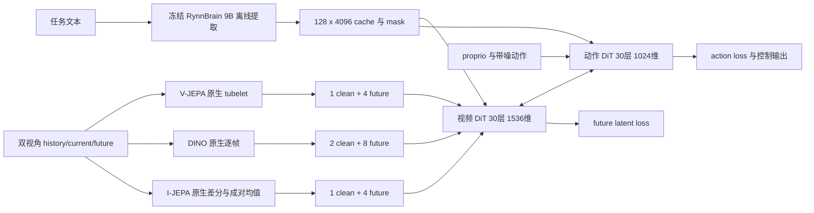

# M29 + RynnBrain 9B 原生 encoder 对比实现

## 比较边界

E00 为 M29 + V-JEPA 2.1 + RynnBrain 1.1-9B baseline。E01/E02 分别替换为原 DINO、I-JEPA 方案。保留每个实现原有的预处理、时序接口、clean 条件数、归一化和必要的可训练适配器，不强制 token 数一致，不新增共享图像时序适配器。

代码以 OpenWAM_v2 为独立宿主快照，迁入 `0penWAM_dino` 的 DINO 实现及 `openwam-ijepa` 的 I-JEPA 实现、官方 I-JEPA ViT。三个来源都含本地修改，具体来源 commit 与关键文件哈希见 `reports/source_snapshot.json`。实际训练使用本目录代码，后续原目录改动不会自动进入本实验。

## 模型结构

文本采用现有 RynnBrain 原生 Qwen3.5 loader 的 text-only 路径。排除输入 embedding，对 32 个 decoder hidden state 分别做 LN 后取均值。右 padding、最长 128 tokens、4096 维 BF16，保留 mask/seq_len；训练只读离线 cache，不常驻 9B 模型。cache 校验模型 fingerprint、固定 system prompt、prompt format、LN eps、dtype、提示词集合及每个 tensor。

两个视角独立编码为 14×14 patch grid，再沿宽拼接为 14×28。视频 DiT 的 patch 为 1×2×2，因此每个时间 latent 有 98 tokens。

| 实验 | 源实现 | 时间处理 | 归一化 | 输出 / Tokens |
|---|---|---|---|---|
| E00 | `encoder/vjepa21.py` | 原生视频 tubelet，history/current 作为 clean，未来 8 帧形成 4 组 | V-JEPA 原生 feature norm | 1408×5×14×28 / 490 |
| E01 | `encoder/dinov3.py` | 不做时间平均；history 和 current 各为一个 clean，8 个未来帧独立 | DINO 原生非 affine feature norm | 1280×10×14×28 / 980 |
| E02 | `encoder/ijepa.py` | clean = current + delta_scale × P(current-history)；8 个未来帧成对均值 | I-JEPA 原生 affine LayerNorm | 1408×5×14×28 / 490 |

E02 的 P 初始化为单位阵、delta_scale 初始化为 0，冻结 ViT，保留 P、delta_scale、affine LN 的训练。宿主原有 `prepare_inputs` 位于 no_grad，所以在这里仅提取冻结的 frame features；本方案专门在 `compute_loss` 内执行 I-JEPA 的原生差分和 LN，确保这部分有梯度。未来 latent target 仍 detach。

视频 DiT：30 层，1536 维，FFN 7168，12 头×128；clean 分支直接投影，future 输入经 256 维 bottleneck。ActionDiT：30 层，1024 维，FFN 4096，每层与视频分支 joint self-attention；action/proprio 均 pad 到 80 维。文本 context 是 4096 维。REPA、S-VAE、AdaFuse 均关闭。clean 不加噪、不计 world loss，推理每步恢复 clean prefix。

## 训练标准

- 数据：`/data/fcy/code/OpenWAM/data/libero`。每个 window 33 个状态、32 个动作；视频 stride=4，window stride=1。视觉相对帧为 `[-4,0,4,8,12,16,20,24,28,32]`，前端处理沿用各 encoder 原实现；双 224×224 视角，关闭 color jitter。
- 预算：4 GPU×64 batch，accumulation=1，global batch=256，10 epochs。按当前 273,465 windows 预计 1,069 steps/epoch、10,690 steps；实际以锁定的 sampler/dataloader 推导值和训练日志为准。
- 初始化：视频策略和动作策略从头初始化，视觉预训练冻结范围按 profile；不复用历史 Cosmos/2B/I-JEPA step12000 策略权重。
- AdamW：LR=1e-4，betas=(0.9,0.95)，weight decay=0.01，grad clip=1；5% warmup + cosine，LR floor=1e-6。
- 目标：video/action 均 x prediction；logit-normal 时间采样，shift video/action=42/5，两个 loss 权重均为 1。
- 执行：BF16、ZeRO-1、gradient checkpointing；无 optimizer/activation offload。H100 默认 SDPA，关闭 fused rope、fused attention、compiled RMSNorm；不启用 compile。
- 种子：42 首轮；43/44 复验。使用相同 seed 并不代表不同形状模型有完全相同初始化。
- 输出：每 500 步保存权重和全状态，最近 3 组；末尾及 STOP_TRAINING 也保留全状态。smoke 与 formal 分目录。

标准预算不使用 `--batch-size` 覆盖。需要效率实验时可覆盖，但应另行标记非标准预算，并在结果中记录；入口 identity 会区分配置，禁止作为标准 run 的精确恢复。

## 资产与溯源

| 资产 | 本机权重目录 | 用途 |
|---|---|---|
| RynnBrain 1.1-9B | `/data/fcy/model/RynnBrain1_1-9B` | 三组共用离线 text encoder |
| V-JEPA 2.1 G | `/data/fcy/code/OpenWAM_v2/assets/vjepa` | E00 |
| DINOv3 H+/16 | `/data/fcy/model/dinov3` | E01 |
| I-JEPA G/16 | `/data/fcy/model/ijepa` | E02，直接用完整 checkpoint.pth.tar |

路径通过 `assets/registry.json` 管理，软链接放在 `assets/pretrained/`。历史权重在 registry 的 references_only 中，仅作记录，不进入新实验初始化。

每次正式启动记录解析配置、完整命令、代码内容 SHA256、cache manifest SHA256/fingerprint、数据元信息 SHA256、预训练文件大小与 mtime。训练目录保存 `experiment_identity.json`、`environment.json`（版本、GPU、可训练/冻结参数数目）、原生 encoder sidecar、部署配置和 normalization stats。metadata hash 不等同于全量视频/parquet 数据内容 hash；默认资产检查也不等同于大权重 SHA256。

## 恢复与评测

精确状态恢复使用 `accel_state_step_*`，恢复 model/optimizer/scheduler/RNG 与 global/opt step、epoch。每个 epoch 样本顺序由 `seed+epoch` 产生，Accelerate 分片；恢复跳过已完成 batch。入口要求相同卡数、batch、配置、源代码与资产身份；未写完整标记的状态不会被选中。CPU 测试已验证状态恢复后的更新一致；四卡 ZeRO 恢复及 GPU 数值行为仍需实机验收。

DINO、I-JEPA 分别保存本地 `dinov3/`、`ijepa/` sidecar 并由各自 `from_skeleton` 重建；策略 checkpoint 包含对应模型参数，无需访问原预训练路径。LIBERO、Plus 入口分别检查原生结构和 clean 条件；Plus 重定位保留原生 sidecar 和文本 fingerprint。部署 buffer 每个控制步更新，图像 encoder 使用 4 步前历史帧与当前帧；V-JEPA 保留自己的 tubelet 历史路径。

共同评测：10 步 denoising、sync、CFG=1、关闭 velocity cache；固定动作执行/重置协议。标准 LIBERO 四 suite×10 tasks×50 trials=2,000；Plus corrected-text 共 10,030 trials。报告成功率、suite/category、样本数、invalid/error；不得将部分 Plus 当完整 overall。

DINO 的 980 tokens、I-JEPA 的可训练适配器与 V-JEPA 的视频预训练能力均是方案本身的一部分。除成功率外必须报告训练吞吐、peak memory、GPU hours 和参数量，不能将结果解释为等 FLOPs 或单一预训练目标消融。

## 验证与扩展

CPU 验证 433 项通过，见 `reports/cpu_validation.log` 和 JUnit。覆盖 native 几何、I-JEPA 适配器梯度、训练 loss、clean attention、严格 checkpoint 重建、批量/普通推理、Plus 重定位、四 rank sampler 分片、Accelerate optimizer/scheduler/RNG 恢复及相关宿主回归。小模型测试使用 tiny/mock encoder，不声称完整大权重已加载验证。

GPU 验收仍需：生成并校验 9B cache；三组各做小 batch smoke；每卡 64 做预热和吞吐/显存测量；四 rank 保存全状态后恢复并检查 optimizer/LR、样本顺序和 loss 连续性。现有四卡 I-JEPA 训练正在占用设备，因此没有启动上述任务。

未来 encoder 的接入口已预留：原生实现与独立 Hydra 配置、独立实验 profile、registry 资产记录及可选 implementation_module。细节见 `examples/encoders/README.md`。需要新的 trainable preprocessing 时单独接入训练桥接与部署逻辑，不强迫归并为 DINO 或 I-JEPA 的时序设计。
